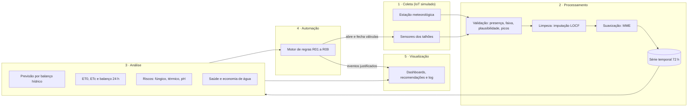

## Integrantes

- Israel Igarashi - RM 98359
- Leonardo Bernardes - RM 99788
- Matheus Medeiros - RM 97774
- Ryan Aquino - RM 550422
- Gabriel Oliveira - RM 98565

# AgroSmart: plataforma inteligente integrada (Fase 6)

Plataforma web que consolida as fases anteriores do projeto AgroSmart em um único sistema funcional, capaz de **coletar** dados do ambiente (IoT simulado), **processar e organizar** essas informações, **executar análises e automações** e **apresentar insights** para apoiar a tomada de decisão na irrigação de uma fazenda.

O cenário é a Fazenda Santa Clara (Rio Verde - GO), fictícia, com quatro talhões irrigados (soja, milho, café e tomate), uma estação meteorológica e válvulas de irrigação controladas pela plataforma.

## Como cada requisito da Fase 6 é atendido

| Requisito | Onde está | O que a plataforma faz |
|---|---|---|
| Coleta de dados do ambiente (IoT ou simulação) | `src/iot/simulator.ts` | 21 dispositivos IoT enviam um pacote a cada ciclo de 10 min: estação meteorológica (temperatura, umidade do ar, radiação, chuva, vento) e, por talhão, umidade, temperatura e pH do solo e hidrômetro. O ambiente evolui por um modelo físico (ciclo diário, frentes de chuva, evapotranspiração, balanço hídrico do solo) e os sensores têm ruído e falhas reais (sem resposta, picos, valores fora da faixa). |
| Processamento e organização de dados | `src/pipeline/` | Cada leitura passa por validação (presença, faixa física, plausibilidade, detecção de picos), limpeza (imputação pelo último valor confiável), suavização (média móvel exponencial) e é organizada em um registro de série temporal por talhão, com retenção de 72 h e contadores de qualidade por sensor. |
| Automação inteligente baseada em análise de dados | `src/analytics/` e `src/automation/` | As análises calculam tendência, **previsão de umidade por balanço hídrico com resposta do solo calibrada pelos próprios dados**, ET0/ETc, balanço hídrico 24 h, risco fúngico, estresse térmico, índice de saúde e economia de água. Um motor de 9 regras priorizadas usa esses resultados para abrir e fechar válvulas e emitir alertas, sempre registrando a justificativa. |
| Visualização analítica | `src/screens/` e `src/components/` | Quatro telas: visão geral (indicadores, mapa da fazenda, recomendações, comparação entre talhões), análise por talhão (umidade com faixa ideal e previsão, temperatura, entradas de água, pH, composição da saúde, estatística descritiva), automação (válvulas, regras, cenários, log de decisões) e dados (fluxo do pipeline, qualidade, dispositivos, exportação CSV/JSON). |

## Arquitetura

As camadas são funções puras encadeadas a cada ciclo por `src/platform/platform.ts`. A interface React apenas lê o estado resultante e envia ações (modo das válvulas, regras, cenários).



Ordem de um ciclo (`advance` em `platform.ts`):

1. o simulador lê o "mundo" com o estado atual das válvulas e gera os pacotes;
2. o pipeline valida, corrige, suaviza e anexa o registro à série temporal;
3. a análise recalcula indicadores e recomendações a partir da série;
4. a automação avalia as regras e altera as válvulas, que valem no ciclo seguinte.

### 1. Coleta (`src/iot/simulator.ts`)

- **Clima:** ciclo diário de temperatura (pico às 15h), umidade do ar inversamente relacionada, radiação solar pela posição do sol e nebulosidade, e uma cadeia de Markov de tempo (aberto, nublado, chuva) típica de estação seca.
- **Solo:** balanço hídrico por talhão (chuva + irrigação − evapotranspiração da cultura − drenagem acima da capacidade de campo). Temperatura do solo acompanha o ar com atraso; o pH oscila em torno do equilíbrio de cada talhão (o talhão 2 é ácido de propósito).
- **Sensores:** ruído de medição, saturação nos limites físicos do transdutor e falhas aleatórias (sem resposta e picos).
- **Eventos do ambiente** injetáveis pela tela de Automação: chuva forte, onda de calor, umidade alta (risco fúngico) e falha de sensor.
- Semente fixa (gerador mulberry32): a mesma semente reproduz a mesma simulação, o que torna os testes determinísticos.

Formato do pacote enviado por dispositivo:

```json
{ "deviceId": "T1-UMI-01", "sourceId": "T1", "sensor": "soilMoisture", "timestamp": "2026-10-10T12:00:00.000Z", "value": 29.4 }
```

### 2. Processamento (`src/pipeline/`)

| Etapa | Regra |
|---|---|
| Presença | `value: null` vira **Ausente** |
| Faixa física | fora do intervalo do sensor vira **Fora da faixa** (ex.: umidade 0-60%, pH 3-10) |
| Plausibilidade | radiação solar acima de 50 W/m² à noite é rejeitada |
| Picos | salto maior que o máximo plausível por ciclo vira **Pico**; a tolerância cresce após falhas seguidas para o sensor se ressincronizar |
| Limpeza | leituras inválidas são substituídas pelo último valor confiável (LOCF) |
| Suavização | média móvel exponencial com fator próprio por sensor |
| Organização | um `TickRecord` por ciclo com clima, talhões, estado das válvulas e quantidade de leituras corrigidas |
| Monitoramento | 3 leituras inválidas seguidas geram evento de falha do dispositivo; a volta gera evento de restabelecimento |

### 3. Análise (`src/analytics/`)

- **Previsão de umidade (12 h) por balanço hídrico:** a demanda atmosférica futura é estimada por persistência (ET0 medida no mesmo horário do dia anterior) e convertida em umidade por uma **resposta do solo calibrada por regressão** sobre os ciclos sem chuva nem irrigação das últimas 24 h. A calibração recupera o parâmetro real do solo simulado (cerca de −1,67 p.p. por mm). Sem 24 h de histórico, a previsão usa a tendência linear das últimas 3 h.
- **ET0** pela variante horária de Hargreaves com a radiação medida; **ETc** = ET0 × Kc da cultura.
- **Balanço hídrico 24 h:** chuva + irrigação − ETc, e volume aplicado em m³ (1 mm em 1 ha = 10 m³).
- **Risco fúngico:** horas com umidade do ar ≥ 85% e temperatura entre 18 e 28 °C nas últimas 24 h.
- **Estresse térmico:** horas acima do limite de conforto da cultura.
- **Índice de saúde (0-100):** umidade (45%), pH (20%), conforto térmico (15%) e qualidade dos dados (20%).
- **Economia de água:** volume aplicado comparado a uma irrigação fixa de 8 mm/dia sem sensores.
- **Recomendações** em linguagem natural, ordenadas por prioridade (crítico, atenção, informativo, sucesso).

### 4. Automação (`src/automation/`)

Regras avaliadas por prioridade. Uma regra de proteção que fecha ou bloqueia a válvula impede as regras seguintes de irrigar naquele ciclo.

| Regra | Condição (a partir das análises) | Ação |
|---|---|---|
| R01 Modo seguro por falha de sensor | sensor de umidade com 3+ leituras inválidas seguidas | fecha a válvula e notifica a manutenção |
| R02 Suspensão por chuva | 0,4 mm ou mais nos últimos 30 min | fecha válvulas e impede novas irrigações |
| R03 Proteção contra excesso hídrico | umidade acima do máximo da cultura | fecha a válvula e alerta encharcamento |
| R04 Encerramento na meta | umidade ≥ meta da irrigação, ou 3 h contínuas | fecha a válvula |
| R05 Janela de menor evaporação | irrigação necessária entre 11h e 15h sem déficit crítico | adia para depois das 15h |
| R06 Irrigação preditiva | abaixo do mínimo, mínimo previsto em até 2 h, ou mínimo previsto dentro da janela 11h-15h | abre a válvula; na antecipação, calcula a lâmina para atravessar o pico de evaporação com 2 p.p. de folga (lâmina mínima de 2 p.p.) |
| R07 Estresse térmico | ar acima do limite da cultura | alerta com recomendação |
| R08 Correção de pH | pH fora da faixa | recomenda calagem ou acidificação |
| R09 Risco fúngico | 6 h+ de condição favorável em 24 h | recomenda inspeção e fungicida preventivo |

Outros comportamentos:

- **Modo manual por talhão:** a automação deixa de acionar a válvula e passa a registrar recomendações; o operador abre e fecha pela interface.
- **Silêncio de alertas:** cada alerta tem um período mínimo entre repetições por talhão.
- **Rastreabilidade:** toda ação registra regra, talhão e os dados que a justificaram (ex.: "Umidade 27,7%: mínimo previsto em ~3,3 h (balanço hídrico), dentro do pico de evaporação. Irrigação antecipada até 34,9%").
- Cada regra pode ser ativada ou desativada na tela de Automação, com contador de disparos.

Em uma simulação de 3 dias sem chuva, a automação faz cerca de uma irrigação por talhão por dia, de manhã, antes do pico de evaporação, e a umidade dos talhões praticamente não cai abaixo do mínimo da cultura (o teste em `src/platform/platform.test.ts` exige menos de 2% do tempo abaixo do mínimo).

### 5. Visualização

| Tela | Conteúdo |
|---|---|
| Visão geral | saúde média, talhões na faixa, água aplicada e economia, alertas; clima atual com ET0 e risco fúngico; mapa clicável dos talhões; recomendações; umidade dos 4 talhões em 48 h; cards por talhão; últimos eventos |
| Talhões | seleção de talhão e janela (12/24/48/72 h); umidade com faixa ideal, períodos de irrigação e previsão de 12 h; temperatura do solo e do ar; entradas de água (chuva x irrigação); pH; composição do índice de saúde; estatística descritiva |
| Automação | válvulas (estado, meta, modo automático/manual); injeção de eventos do ambiente; regras com condição, ação, disparos e ativação; log de decisões filtrável por origem |
| Dados | fluxo do pipeline com contagens; qualidade por tipo de sensor; formato do pacote IoT; tabela de dispositivos (bruto, processado, qualidade, falhas seguidas); exportação da série temporal (CSV) e dos eventos (JSON); equipe |

Os gráficos são SVG próprios, com tooltip por cursor ou teclado (setas), legenda, faixa ideal e tabela de dados acessível em cada gráfico. As cores dos talhões são fixas e foram validadas para daltonismo contra o fundo escuro.

A simulação roda ao vivo: cada segundo processa 10 min, 1 h ou 6 h de operação (controle no topo), pode ser pausada e reiniciada com nova semente. Ao abrir, a plataforma gera 48 h de histórico.

## Como rodar

Requer Node.js 22.12 ou superior (exigência do Vitest; o app em si roda a partir do Node 20.19).

```bash
npm install
npm run dev
```

O login aceita qualquer e-mail válido com senha de 6+ caracteres, ou o botão **Entrar em modo demonstração**. Não há backend nem persistência: toda a plataforma roda no navegador.

```bash
npm test          # 27 testes: pipeline, análises, regras e integração
npm run lint
npm run build     # build de produção em dist/
```

## Roteiro sugerido de demonstração

1. **Visão geral:** apresente os indicadores, o mapa e as recomendações. Mude a velocidade para 1 h/s e observe as irrigações automáticas de manhã.
2. **Talhões:** abra um talhão, mostre a previsão de 12 h, a faixa ideal e os períodos de irrigação. Explique a calibração da resposta do solo no card "Previsão de déficit".
3. **Automação:** clique em **Chuva forte** e veja as regras R02 e R03 agirem no log. Depois clique em **Falha de sensor** e acompanhe o pipeline imputar os dados, o R01 colocar o talhão em modo seguro e o restabelecimento do sensor. Coloque um talhão em modo manual para ver as recomendações no lugar das ações.
4. **Dados:** mostre o fluxo do pipeline, a qualidade por sensor, os dispositivos com leituras corrigidas e exporte o CSV.

## Estrutura

```
src/
  domain/      tipos, fazenda, culturas, catálogo de sensores e fórmulas agronômicas
  lib/         gerador aleatório com semente, fuso horário e formatação pt-BR
  iot/         simulador da rede de sensores e dos eventos do ambiente
  pipeline/    validação, limpeza, suavização e série temporal
  analytics/   estatística, previsão, indicadores e recomendações
  automation/  catálogo de regras e motor de automação
  platform/    orquestrador do ciclo, hook React, seletores e exportação
  components/  gráficos SVG, mapa, log de eventos e componentes de interface
  screens/     login, visão geral, talhões, automação e dados
  test/        fixtures dos testes
```

## Limitações e próximos passos (Fase 7)

- Substituir o simulador por sensores reais (ESP32 + LoRaWAN/MQTT) mantendo o mesmo formato de pacote.
- Persistir a série temporal em um banco de séries temporais e mover o pipeline para um backend.
- Incorporar previsão meteorológica externa na decisão de irrigar (hoje a chuva só é considerada quando já está ocorrendo).
- Evoluir a previsão por balanço hídrico para um modelo treinado com histórico de várias safras.

## Origem do código

Esta plataforma evoluiu a partir do protótipo *Lunar H2O Rover* (Global Solution, 1º semestre), reaproveitando a stack (React, TypeScript, Vite, Lucide), o sistema visual e o fluxo de login.
